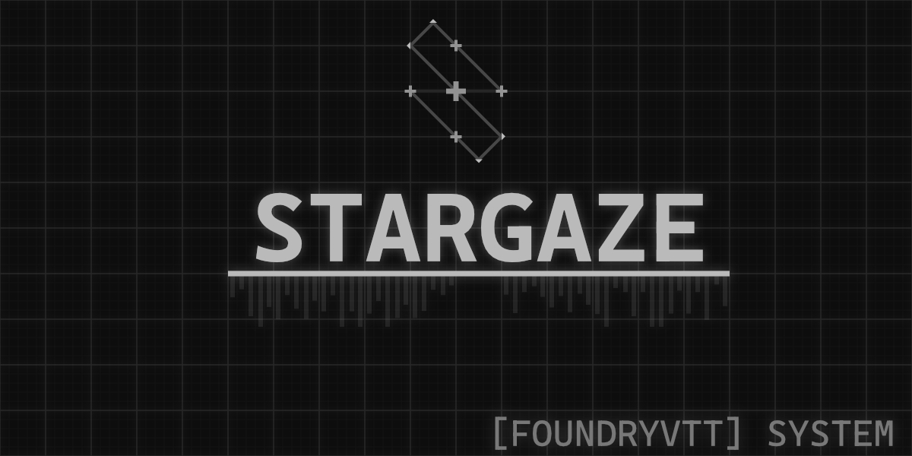

**English** | [Русский](README.ru.md) 

# Stargaze

A science-fiction setting and tabletop role-playing game system.

Stargaze is designed with flexibility, convenience, and ease of use in mind. The system is well-suited for players coming from **D&D 5e** or **Cyberpunk RED**.

The combat system is built around reactions and keeps players engaged throughout the entire fight. Character creation is deep yet intuitive — you can build anything from a heroic expert marksman to a raging alcoholic hacker.

This is a side project I maintain for creative expression, JavaScript practice, and experience writing comprehensive documentation and wikis.

I’d be glad if the system interests you and you use it in your games.

## Repositories

| Name | Repository |
|------|------------|
| System for [Foundry VTT](https://foundryvtt.com) | [stargaze-foundryvtt](https://github.com/stargaze-ttrpg/stargaze-ttrpg-foundryvtt) |
| Wiki (Russian) | [stargaze-wiki-ru](https://github.com/stargaze-ttrpg/stargaze-ttrpg-wiki-ru) |
| Wiki (English) | [stargaze-wiki-eng](https://github.com/stargaze-ttrpg/stargaze-ttrpg-wiki-eng) |

## License

This project is licensed under the **MIT License**.

You are free to use, modify, distribute, and use the materials commercially. The only requirement is to preserve the copyright notice.

The author accepts no liability for the use of these materials.