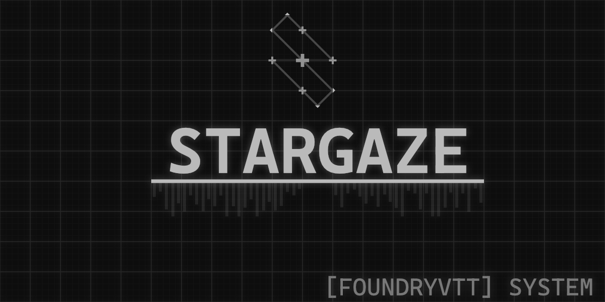

[English](README.md) | **Русский**

# Stargaze

Научно-фантастический сеттинг и игровая система для настольных ролевых игр.

Stargaze ориентирован на гибкость, удобство и простоту восприятия. Система хорошо подходит для перехода с **D&D 5e** или **Cyberpunk RED**.

Боевая система построена на реакциях и держит участников вовлечёнными на протяжении всего боя. Создание персонажа глубокое и интуитивно понятное — можно собрать как героического эксперта-стрелка, так и бушующего алкоголика-хакера.

Это сторонний проект, который я веду для творческой реализации, практики в JavaScript и опыта написания комплексной документации и вики.

Буду рад, если система покажется вам интересной и вы будете использовать её в своих играх.

## Репозитории

| Название | Репозиторий |
|----------|-------------|
| Система для [Foundry VTT](https://foundryvtt.com) | [stargaze-foundryvtt](https://github.com/stargaze-ttrpg/stargaze-ttrpg-foundryvtt) |
| Вики (Русский) | [stargaze-wiki-ru](https://github.com/stargaze-ttrpg/stargaze-ttrpg-wiki-ru) |
| Вики (English) | [stargaze-wiki-eng](https://github.com/stargaze-ttrpg/stargaze-ttrpg-wiki-eng) |

## Лицензия

Проект распространяется под лицензией **MIT**.

Вы можете свободно использовать, изменять, распространять и использовать в коммерческих целях любые материалы проекта. Единственное требование — сохранять уведомление об авторстве (copyright notice).

Автор не несёт никакой ответственности за использование материалов.
